# FORJA — Spec 驱动的 AI 锻造坊

> **规格入炉，交付出炉。** 以 Spec 为唯一事实源、Agent 为执行引擎的一站式 AI 研发平台：
> 需求 → 规格 → 任务 → AI 锻造（门禁 + 自动修复）→ 构建镜像 → 交付包 → 客户部署 → 验收回炉。

📖 **在线文档**：https://iamartinlong.github.io/Forja/ ｜ 📄 **项目介绍 PDF**：https://iamartinlong.github.io/Forja/downloads/FORJA-项目介绍.pdf ｜ 🎬 **演示视频**：https://iamartinlong.github.io/Forja/作品视频演示.mp4

## 技术栈

| 层 | 选型 |
|----|------|
| 后端 | Go 1.24 · Fiber · pgx/sqlc · asynq（Redis 队列） |
| 前端 | React 19 · TypeScript · Vite · TanStack Query/Router · Tailwind + shadcn/ui |
| 数据 | PostgreSQL 16（pgvector）· Redis 7 |
| 研发流水线 | Gitea + Gitea Actions（仓库托管 / CI / 制品与交付） |
| Agent | OpenCode Server（OpenAI 兼容 Provider / 可切私有化模型） |

## 界面总览

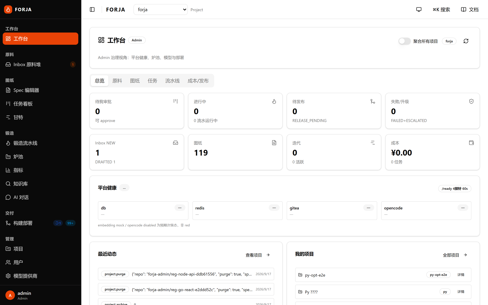

<details>
<summary>更多截图（项目 / 锻造 / 交付 / 治理）</summary>

| 项目列表 | 项目详情（交付 · 成本 · 动态） |
|---|---|
| 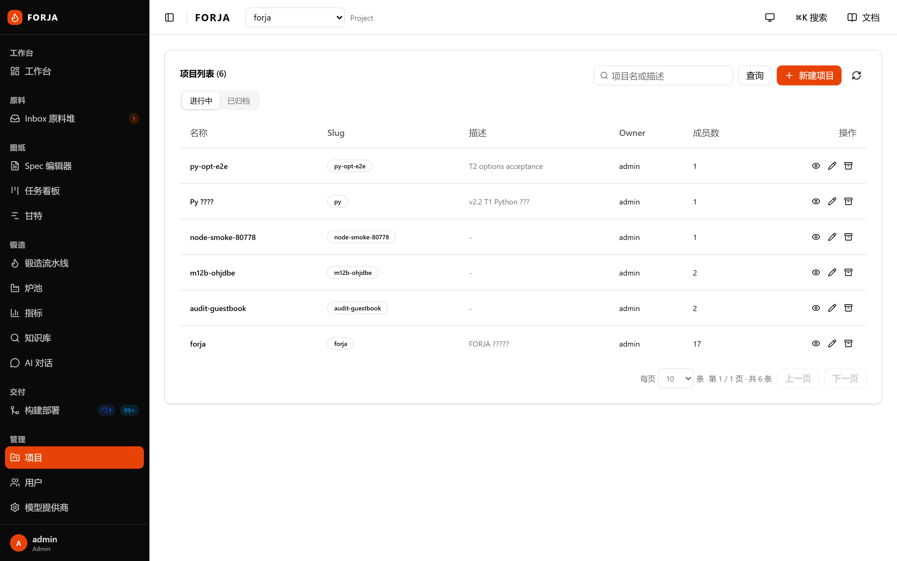 | 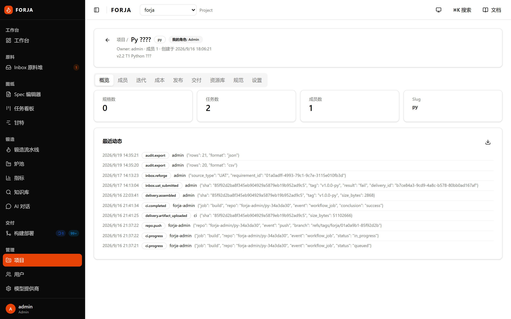 |

| 原料收件箱 | 规格详情 |
|---|---|
| 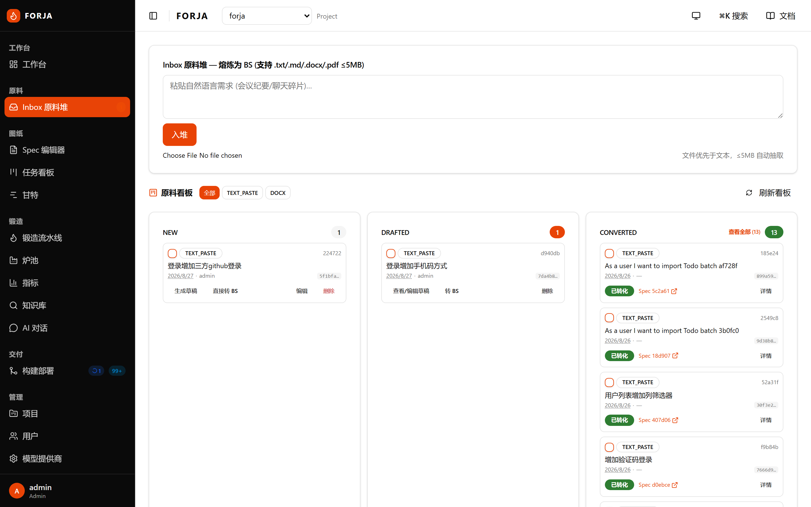 | 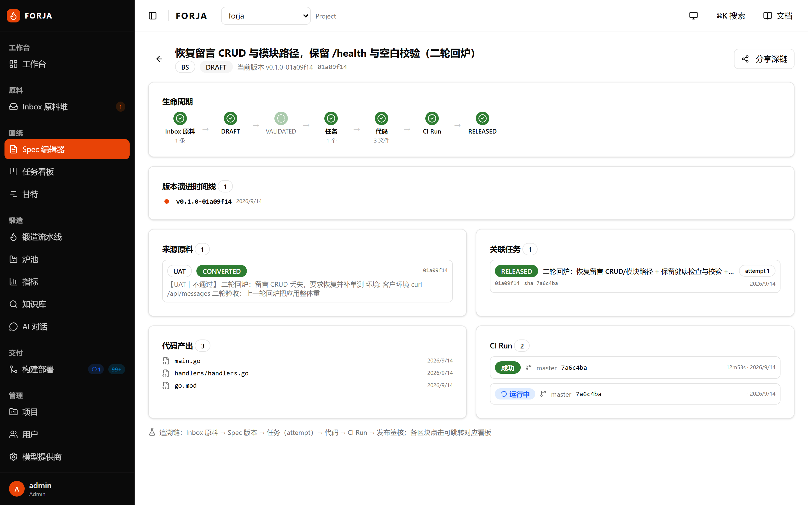 |

| 任务看板 | 锻造面板（门禁 / 轮次 / 签核） |
|---|---|
| 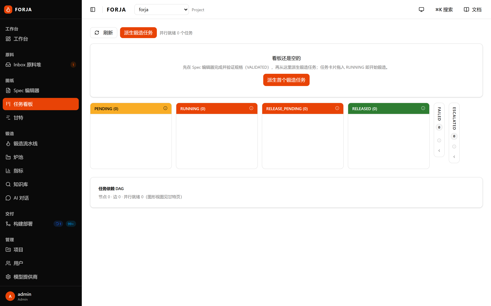 | 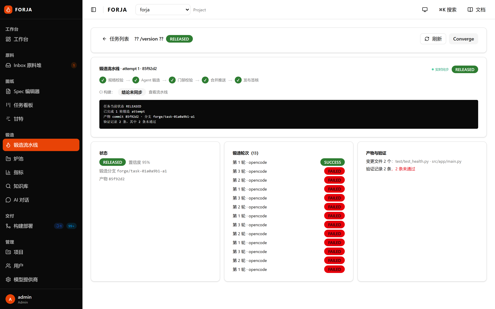 |

| 构建部署（流水线） | 构建部署（部署记录） |
|---|---|
| 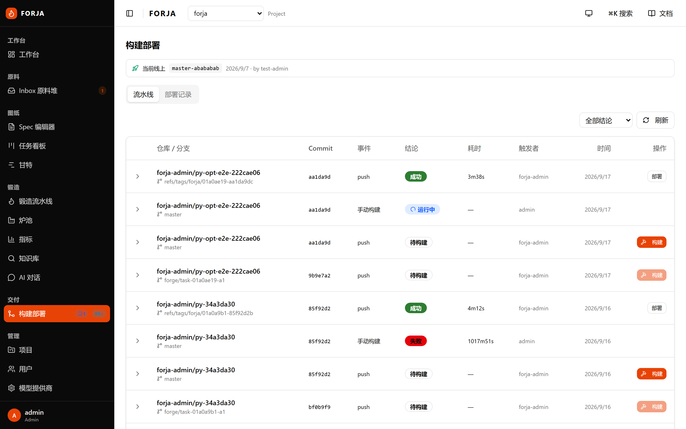 |  |

| 指标与成本分包 | 用户管理（分页） | 炉池 |
|---|---|---|
| 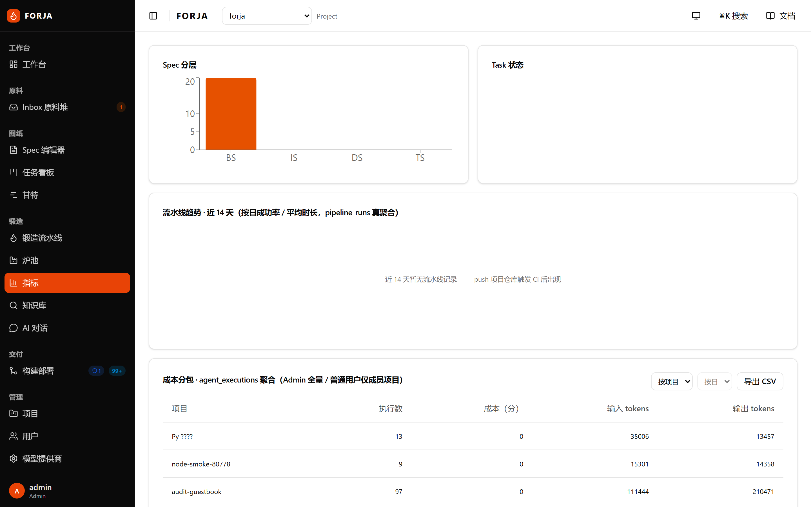 | 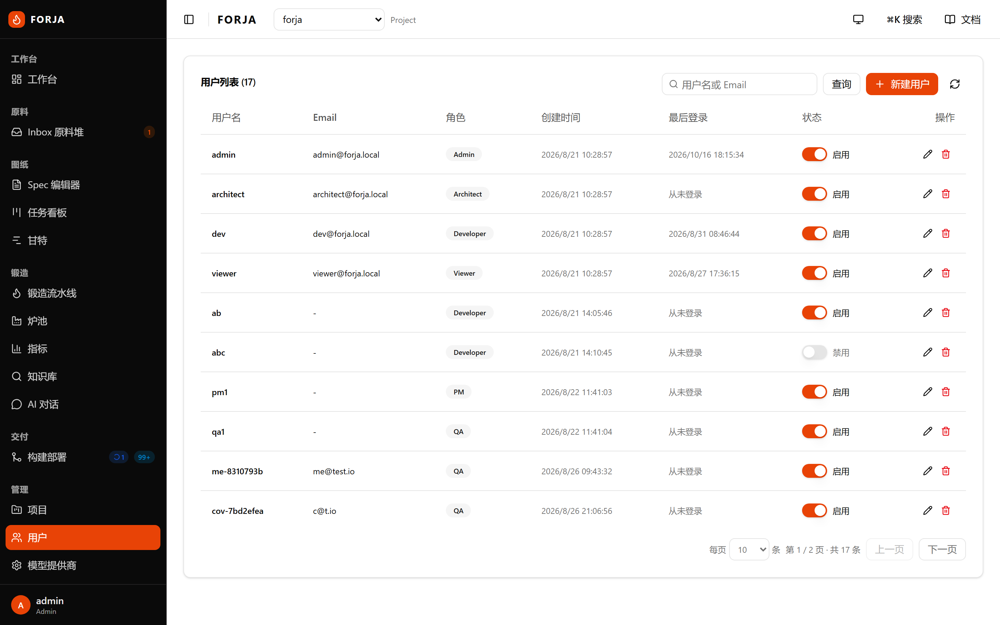 | 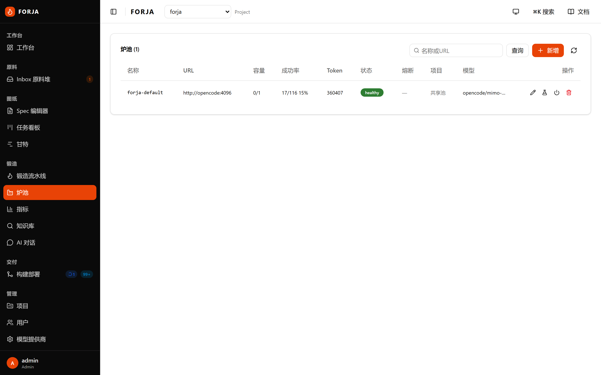 |

</details>

## 核心能力

- **Spec 体系**：BS/IS/DS/TS 四层规格 + Clarify 门禁（WHAT/WHY 禁 HOW），契约优先（OpenAPI/Pact）。
- **锻造门禁**：静态检查 → 构建 → 单测 → 覆盖率（lcov），失败自动修复 ≤3 轮，人工签核后合并。
- **多栈模板 + 参数化**：Go / Node / Python 三栈模板，建项问卷（enum/bool）实时渲染落仓。
- **交付通道**：构建镜像 → 交付包（compose / 部署手册 / CHANGELOG / Release Notes）→ 客户环境自部署。
- **验收回炉闭环**：UAT 不通过 → 一键生成修复任务（幂等），携带交付上下文。
- **可观测与治理**：流水线/制品/交付台账、审计留痕与导出、成本分包（项目/周期）、密钥轮换双钥。

## 目录

```
backend/          Go 服务（api / worker / storage 三个入口 + internal/* 领域包）
frontend/         React 应用（组件、路由、E2E、截图脚本）
backend/db/migrations/  数据库迁移（顺序执行）
specs/ · rules/   Spec 体系与工程规则样例
site-docs/        站点文档（VitePress，发布到 GitHub Pages）
```

> 生产部署清单、CI/CD 流水线定义与内部运维文档不在本公开快照内（见私有仓库）。

## 快速开始（本地）

```bash
# 1) 基础设施（PostgreSQL/Redis/Gitea）
docker compose -f docker-compose.yml -f compose.dev.yml up -d postgres redis gitea

# 2) 后端（默认 :8080，读取 DATABASE_URL / REDIS_ADDR，见根 .env）
make dev-api        # 或: cd backend && go run ./cmd/server

# 3) 前端（:5173，代理 /api 到后端）
make dev-web        # 或: cd frontend && npm i && npm run dev
```

常用校验：`make vet`（go vet）· `make test`（后端测试）· `make build`（后端 + 前端产物）。

## 文档与站点

- 在线文档（VitePress）：https://iamartinlong.github.io/Forja/
- 项目介绍 PDF：https://iamartinlong.github.io/Forja/downloads/FORJA-项目介绍.pdf
- 本地构建文档：`cd site-docs && npm ci && npm run docs:build`
- 重新采集系统截图：`node frontend/scripts/capture-screenshots.mjs`（需先本地/内网可达运行环境，默认 `http://localhost:8080`）

## 许可

未附许可文件；如需商用或再分发请先联系作者。
